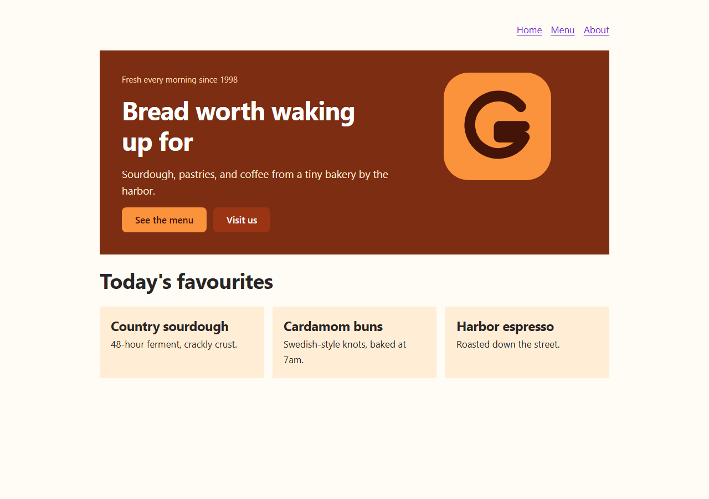

# Genesis+

Genesis+ is a small programming language for building websites. You describe a page with a few readable elements — headings, text, rows, columns, links, buttons, images — and the compiler turns it into plain HTML and CSS that work in any browser.

```gns
page Home {
    column gap = 16 padding = 32 background = "#f5f3ff" {
        heading "Welcome to Genesis+" color = "#7c3aed"
        text "Build websites without fighting your tools."
        button "Get started" to = "#start"
    }
}
```


*The `examples/landing` project, compiled by Genesis+ and rendered in Microsoft Edge.*

## Why Genesis+

- **Readable.** A page reads like an outline of what you see. There are eight elements and eleven properties.
- **Braces, not indentation.** Blocks use `{ }`, so code copied from chat assistants, websites, or another editor works even if tabs turn into spaces or the indentation gets mangled.
- **Helpful errors.** Mistakes are reported with the line, the column, the source line with a marker, and a hint about how to fix it.
- **Good defaults.** Pages look tidy and work on phones without writing any CSS. Rows stack vertically on narrow screens.
- **Safe output.** All text is HTML-escaped, colors and sizes are validated, and links cannot use `javascript:` addresses.
- **No dependencies.** The compiler is a single C17 program. The generated website is static HTML and CSS with no JavaScript.

## Features

| Area | What you get |
| --- | --- |
| Elements | `page`, `column`, `row`, `heading`, `text`, `link`, `button`, `image` |
| Styling | text size and color, heading levels, alignment, backgrounds, gaps, percentage widths, padding (all sides, axes, or individual sides) |
| Sites | multiple pages per file, page titles, an `assets/` folder copied into the output |
| Tools | `genesis build`, `genesis dev` (local server with automatic rebuild and page reload), `genesis check`, `genesis fmt`, `genesis init` |
| Editor | VS Code extension with highlighting, live error checking from the compiler, completion, hovers, snippets, and formatting |

## Requirements

- A C17 compiler: GCC 8 or newer, or Clang. The project is developed with GCC from MSYS2 UCRT64 on Windows and is written to also build on Linux and macOS.
- GNU Make.
- Optional: Node.js 18+ to run the VS Code extension tests; `curl` to run the dev-server tests.

## Installation

Genesis+ is currently installed by building it from source. No prebuilt binaries have been published.

### Windows (MSYS2 UCRT64)

1. Install [MSYS2](https://www.msys2.org/).
2. Open the **MSYS2 UCRT64** terminal and install the toolchain:

   ```bash
   pacman -S --needed mingw-w64-ucrt-x86_64-gcc make
   ```

3. Go to the project folder and build:

   ```bash
   cd /c/path/to/genesis
   make
   ```

   This produces `genesis.exe` in the project folder.

4. Optional: to run `genesis` from any folder, add the project folder (or wherever you copy `genesis.exe`) to your Windows `PATH`. The program only depends on Windows system libraries.

### Linux and macOS

```bash
make
sudo make install        # optional: copies genesis to /usr/local/bin
```

On macOS, install the Xcode Command Line Tools first (`xcode-select --install`).

## Getting started

These steps assume `genesis` is on your `PATH` (see [Installation](#installation)). If it is not, use the full path to the compiler instead, for example `/c/path/to/genesis/genesis.exe check` in MSYS2 or `..\genesis.exe check` in PowerShell.

**1. Build Genesis+** as described in [Installation](#installation), then check it works:

```bash
genesis --version
```

**2. Create a project:**

```bash
genesis init my-site
cd my-site
```

This creates `lead.gns` (a starter page), an `assets/` folder for images, and a `.gitignore` that excludes the generated `dist/` folder. Existing files are never overwritten.

**3. Write a page.** Replace the contents of `lead.gns` with:

```gns
page Home title = "My first site" {
    heading "Hello, world!"
    text "This page was built with Genesis+."
    button "Learn more" to = "https://example.com"
}
```

**4. Check it for mistakes** without writing any files:

```bash
genesis check
```

You should see `lead.gns: no problems found.` If there is a mistake, the message shows the line, the column, and how to fix it.

**5. Build the website:**

```bash
genesis build
```

The site is written to `dist/`: `index.html`, `style.css`, plus one `.html` file for each extra page and a copy of `assets/`.

**6. Open the result.** Open `dist/index.html` in any web browser (double-click it, or drag it into a browser window). The generated site is plain HTML and CSS and works straight from disk.

**7. Preview while you edit:**

```bash
genesis dev
```

Open <http://localhost:3000/>. Every time you save `lead.gns` (or change something in `assets/`), the site is rebuilt and the page reloads by itself. If there is an error, the browser shows it. Press `Ctrl+C` to stop.

**8. Install the VS Code extension** for colors, live error checking, completion and formatting. It is not on the Marketplace yet; run it from this repository instead:

1. Open the repository folder in VS Code and build the compiler (`make`).
2. Press **F5** and choose **Launch Genesis+ Extension**. A second VS Code window opens with the extension loaded.

See [vscode-extension/README.md](vscode-extension/README.md) for settings and packaging.

**9. Report a bug** by opening an issue with the *Bug report* template (`.github/ISSUE_TEMPLATE/bug_report.md`). Include `genesis --version`, your operating system, the smallest `.gns` file that shows the problem, and the full output. Report security problems privately as described in [SECURITY.md](SECURITY.md).

Publishing: upload the contents of `dist/` to any static web host (for example GitHub Pages or Netlify).

## Commands

| Command | What it does |
| --- | --- |
| `genesis build [file-or-folder]` | Compile `lead.gns` (or the given file) into `dist/` next to it. |
| `genesis dev [file-or-folder] [--port N]` | Build, serve `dist/` on `http://localhost:3000/`, rebuild on changes, reload open pages. |
| `genesis check [file-or-folder]` | Report errors and warnings without writing files. |
| `genesis fmt [file-or-folder] [--check]` | Rewrite a file in the standard format. |
| `genesis init [folder]` | Create a starter project. Never overwrites existing files. |
| `genesis help [command]`, `genesis --version` | Help and version information. |

Exit codes: `0` success, `1` compile or build failure, `2` invalid command-line usage. See [docs/cli.md](docs/cli.md) for every option.

## A complete example

```gns
# Comments start with #.
page Home title = "Harbor Bakery" background = "#fffbf5" {
    row gap = 32 padding = 40 background = "#7c2d12" {
        column width = 60% gap = 16 {
            heading "Bread worth waking up for" color = "#ffffff" size = 46
            text "Sourdough, pastries, and coffee by the harbor." color = "#ffedd5"
            button "See the menu" to = "menu.html" background = "#fb923c" color = "#431407"
        }
        column width = 40% align = "center" {
            image "assets/logo.svg" alt = "Harbor Bakery logo" width = 60%
        }
    }
}

page Menu {
    link "Back to home" to = "index.html"
    heading "Menu"
    text "Country sourdough - $7"
}
```

The first page becomes `dist/index.html`; the others are named after the page (`dist/menu.html`). The full version of this site is in [examples/showcase](examples/showcase/lead.gns).



## Migrating from indentation-based files

Early development builds of Genesis+ used `:` and indentation to mark blocks. Since 0.9.0, blocks use braces. Replace each `:` that opens a block with `{`, and add a `}` after the block's last item:

Before (no longer accepted):

```
page Home:
    column:
        heading "Welcome!" size = 36
        text "Hello!"
```

After:

```gns
page Home {
    column {
        heading "Welcome!" size = 36
        text "Hello!"
    }
}
```

The compiler recognises the old style and points at each `:` with instructions. Element and property names did not change. Once a file compiles, `genesis fmt` tidies the indentation.

## Documentation

- [Tutorial: build your first website](docs/tutorial.md)
- [Language reference](docs/language-reference.md): every element, property, value, and error
- [Command-line reference](docs/cli.md)
- [Examples](examples/): `minimal`, `landing`, `layout`, `spacing`, `responsive`, `showcase`
- [VS Code extension](vscode-extension/README.md)
- [Compiler architecture](docs/architecture.md), for contributors
- [Contributing](CONTRIBUTING.md) · [Changelog](CHANGELOG.md) · [Versioning](docs/versioning.md) · [Release checklist](docs/release-checklist.md)

## Building and testing the compiler

```bash
make clean      # remove build output and the compiler binary
make            # build genesis (genesis.exe on Windows) with strict warnings
make test       # the release gate: builds first, then runs every test; non-zero exit on any failure
make examples   # compile every example
make analyze    # GCC static analyzer
make sanitize   # C tests under AddressSanitizer + UBSan (Linux/macOS only; refuses on Windows)
make install    # copy the compiler to $(PREFIX)/bin, default /usr/local/bin
```

`make test` runs, in order:

1. `check-eol`: every text file must use LF line endings;
2. `test-unit`: lexer, parser, code generation, formatter, dev-server path rules, golden files, and fuzzing;
3. `test-cli`: the command-line tool end to end, including the dev server (needs `curl`), every example, and every `gns` code block in the documentation;
4. `test-extension`: the VS Code extension tests (needs Node.js 18+; reported as SKIPPED otherwise), run against the compiler that was just built.

To use a specific compiler binary for the extension tests, set `GENESIS_BIN`. If it is set but does not exist or does not run, the tests fail instead of falling back to another binary.

## Troubleshooting

| Problem | Fix |
| --- | --- |
| `genesis: command not found` | Use the full path to the compiler, or add its folder to `PATH` (Windows) / run `make install` (Linux, macOS). |
| `make: gcc: command not found` on Windows | Use the **MSYS2 UCRT64** terminal, not the plain MSYS2 one, and install `mingw-w64-ucrt-x86_64-gcc`. |
| `No lead.gns found in the current folder` | Run the command inside your project folder, pass the file (`genesis build site.gns`), or create a project with `genesis init`. |
| `Genesis+ now uses braces instead of ':'` | Your file uses the old syntax. See [Migrating](#migrating-from-indentation-based-files). |
| `Found a curly quote` | Your editor or chat app turned `"` into `“ ”`. Retype the quotes as plain `"`. |
| `port 3000 is already in use` | Stop the other program, or run `genesis dev --port 3001`. |
| Images missing on the built site | Put them in `assets/` next to `lead.gns` and write `image "assets/name.png"`. Names are case-sensitive on most web hosts. |
| A deleted page is still in `dist/` | Genesis+ never deletes files. Delete `dist/` and build again. |
| `tests/cli_test.sh: set: Illegal option -` | The script has Windows (CRLF) line endings. Check out the repository again with the included `.gitattributes`, or convert the file to LF. `make check-eol` lists affected files. |
| The VS Code extension shows no errors | It needs the compiler: build it, then set `genesis.compilerPath` or put `genesis` on `PATH`. Check the *Genesis+* output channel. |

## Known limitations

- **No custom CSS or JavaScript.** Styling is limited to the documented properties. This is deliberate for now.
- **Colors** must be hex values (`#RGB` or `#RRGGBB`). Color names such as `"red"` are not supported.
- **Sizes** are whole pixels; **widths** are percentages. There are no other units.
- **One source file per site.** Put all pages in one `.gns` file; there is no `import`.
- **Local images** must live in the `assets/` folder next to the `.gns` file. The whole folder is copied to `dist/assets/`.
- **Stale pages are not deleted.** If you remove or rename a page, its old `.html` file stays in `dist/` until you delete it. Genesis+ never deletes files.
- **Rows always stack** below 640 pixels wide; this cannot currently be turned off.
- **The dev server** is for local development only. It listens on `127.0.0.1`, serves one request at a time, and checks for changes by polling twice a second. Reloading uses a small script that the server adds to pages it serves; files in `dist/` are not changed.
- **Windows paths:** on Windows, project paths containing non-ASCII characters may not work, because the compiler uses the standard C file functions. Paths with spaces work.
- **The optional *Genesis+ Icons* theme** in the VS Code extension only provides the `.gns` icon. The language icon is shown automatically by themes that support language icons.

## Project status

Genesis+ **0.9.0 is the public testing release** and has not been published yet. The language may still change before 1.0; breaking changes will be listed in the [changelog](CHANGELOG.md) with migration steps (see [versioning](docs/versioning.md)).

Outstanding before publication (details in [docs/release-checklist.md](docs/release-checklist.md)):

- The **copyright holder** in `LICENSE` is a placeholder.
- The **GitHub repository URL** has not been added to the extension metadata.
- **Continuous integration** has not run yet (the repository has no GitHub remote). Linux and macOS builds are unverified until it does.
- Some **VS Code extension** checks need a person at the keyboard, and the extension is not published to the Marketplace.

## License

Genesis+ is released under the [MIT License](LICENSE). The VS Code extension in `vscode-extension/` is under the same license.

## Contact

Questions, conduct reports and security reports: [Jmcustoms1609@gmail.com](mailto:Jmcustoms1609@gmail.com). Please report security problems privately (see [SECURITY.md](SECURITY.md)); report bugs as GitHub issues once the repository is public.
